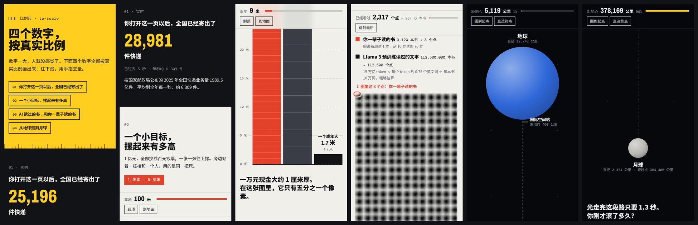

# 比例尺 · to-scale

**把任何数字，按真实比例画给你看。** 一个开源 Claude Skill。



> 示例页：快递实时计数、一个亿摞起来有多高、AI 读过的书 vs 你一辈子读的书、从地球滚到月球。
> 下载 [`examples/four-numbers.html`](examples/four-numbers.html) 用浏览器打开，往下滚。

## 为什么做这个

"38 万公里""1.1 亿本书""每秒 6,309 件"，这些数字读完就忘，因为人脑对大数字没有感觉。

但只要按真实比例画出来，让人用手指一屏一屏滚过去，感觉就回来了。网上那些"按比例滚动"的网页（比如把财富、宇宙按 1 像素一个单位排开）一次次刷屏，原因就在这里。只是以前每做一个都要专门写代码。

装上这个 skill，跟 Claude 说一句「把 ×× 按比例画出来」，几分钟就能得到一个这样的页面。

## 它会做什么

1. **查数据**：需要事实就联网核实，记下来源、年份和统计口径，不编数字。
2. **挑参照物**：楼层、足球场、京沪高铁、一辈子……让大数字有个能对照的东西。
3. **算比例尺**：保证在手机上放得下、滚起来不累、不超过浏览器的像素上限。
4. **生成页面**：用自带引擎渲染四种场景，比例由程序计算，不靠模型手写坐标。
5. **写清楚假设和来源**：每个估算的换算步骤都标在页面上。

## 四种场景

| 场景 | 适合 | 例子 |
|---|---|---|
| **标尺** ruler | 距离、深度、时间跨度 | 地球到月球、马里亚纳海沟、人类史在地球史里的长度 |
| **堆叠** stack | 谁高谁矮 | 一个亿摞起来 vs 楼房、各家模型参数量 |
| **点阵** dots | 多少个、悬殊对比 | AI 读的书 vs 你读的书、万分之一的概率 |
| **计数器** ticker | 每秒发生多少 | 每秒寄出的快递、每秒出生的人 |

## 诚实规则

比例尺的价值全在"真实"：
- 每个场景都写明"1 像素 = 多少"
- 物体大小和距离用同一把尺
- 不截断、不用对数轴、不做 3D
- 估算的每一步假设都写在页面上
- 小到不足 1 像素的东西照实标注

## 安装

**Claude 网页版 / App**：把 `to-scale` 文件夹打成 zip，在设置中的 Skills 处上传（需要开启代码执行）。

**Claude Code**：
```bash
mkdir -p ~/.claude/skills && cp -r to-scale ~/.claude/skills/
```

## 用法

装好以后直接说：

```
把中国一年的快递量按比例画出来
马里亚纳海沟有多深？按比例做一页
我们的新接口比旧的快 40 倍，做个能发给老板的比例图
全世界每秒出生多少人，做个实时计数
我月薪 1.5 万，在上海买一套 70 平的房要攒多少年，按比例画
```

它会在回复里给出一句话结论、生成的页面，以及一句适合转发的文案。

## 不用 Claude 也能用

引擎是一个独立的 HTML 文件，可以手写配置：

```bash
python3 scripts/toscale.py suggest --length 384400 --bodies 12742 3474 --unit 公里   # 看候选比例
python3 scripts/toscale.py build my.json -o my.html                                  # 校验并生成
```

配置格式见 `SKILL.md` 的「配置格式」一节，完整示例见 `examples/four-numbers.json`。没有 Python 时，直接改 `assets/engine.html` 里 `TOSCALE CONFIG` 之间的那段 JSON 也行。

## 目录

```
to-scale/
├── SKILL.md              # 给 Claude 的说明：工作流、诚实规则、场景选择、配置格式
├── assets/engine.html    # 渲染引擎（单文件，无依赖，只从 Google Fonts 加载字体）
├── scripts/toscale.py    # 算比例 / 校验配置 / 生成页面（只用 Python 标准库）
├── references/anchors.md # 参照物库：常用长度、面积、时间、数量
└── examples/             # 示例配置、生成的页面、预览图
```

## 参与贡献

欢迎：
- 新的场景类型（缩放阶梯、面积嵌套是下一步最想要的）
- 更多参照物（请附来源）
- 用它做出来的好例子

## English

**to-scale** is an open-source Claude Skill that turns any number into a true-to-scale, scrollable web page you can *feel*: rulers for distances, stacks for heights, dot fields for counts, and live tickers for rates. It verifies data, picks familiar reference objects, computes a scale that fits on phones and within browser limits, and renders with a bundled engine, so proportions are computed by code rather than guessed by the model. Every page states its scale, sources and assumptions.

## 许可

MIT © 2026 朝礼
